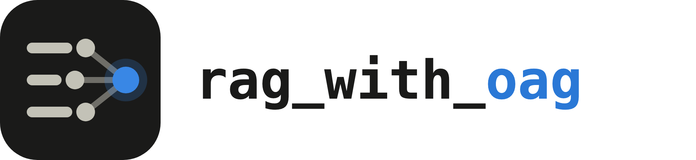
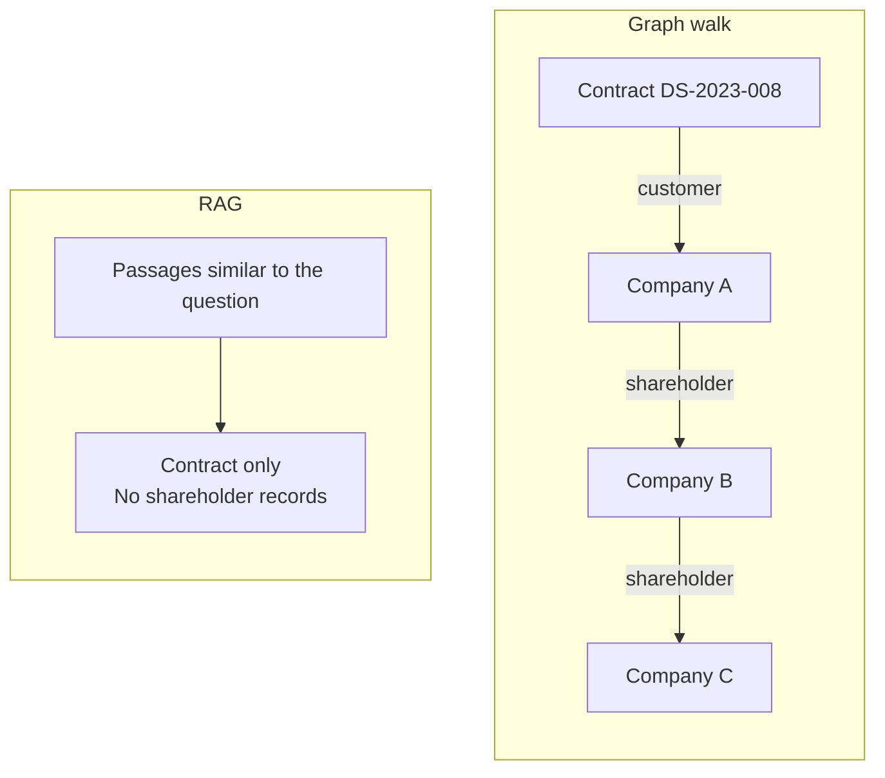
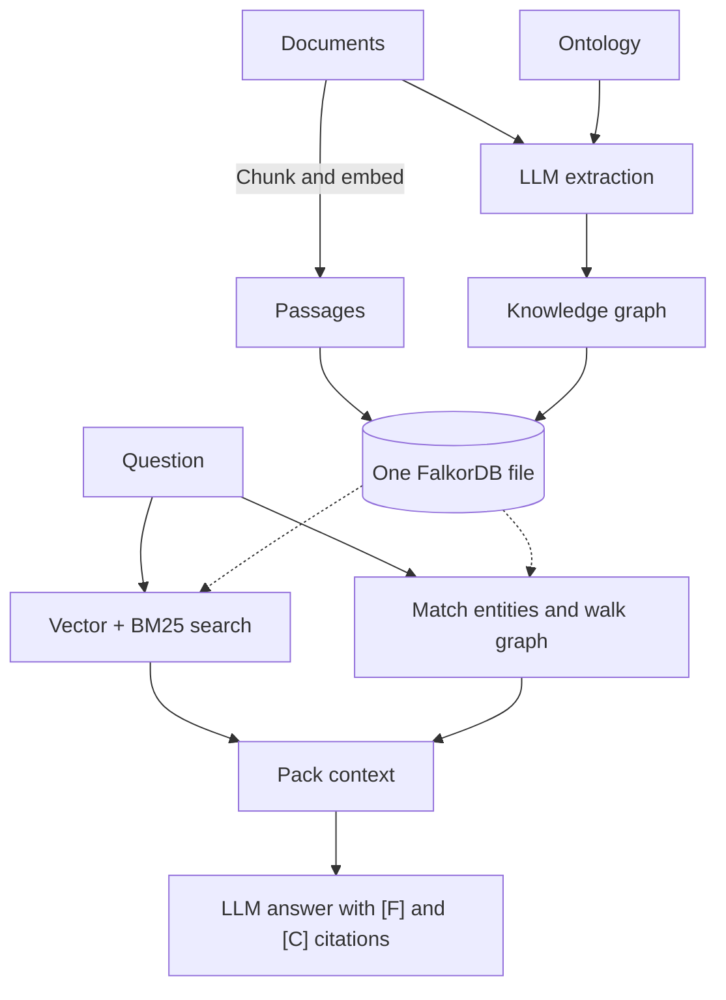

<h1 align="center">
  <picture>
    <source media="(prefers-color-scheme: dark)" srcset="docs/brand/logo-wordmark-dark.png">
    
  </picture>
</h1>

<p align="center">
  <a href="https://pypi.org/project/rag-with-oag/"></a>
</p>

Ask questions about your documents, including questions whose answer is spread
over several documents. `rag_with_oag` is a Python library with three modes.

- **RAG** finds passages similar to the question.
- **OAG** (ontology-augmented generation) builds a knowledge graph from your ontology and walks its relations.
- **Hybrid** (default) gives the model both graph facts and source text.

> **Status: v0.2, pre-alpha.** The API may still change.

## Why a graph?

Who is the largest shareholder of the largest shareholder of the customer in
contract DS-2023-008? The answer is three hops away across the contract and two
shareholder records. Plain RAG can pick a similar but incomplete passage.



## Results

<p align="center">
  <picture>
    <source media="(prefers-color-scheme: dark)" srcset="docs/images/rag_vs_hybrid-dark.png">
    
  </picture>
</p>

On held-out synthetic Turkish contracts, hybrid answered 94% correctly and RAG answered 39%.
On 500 real Wikipedia questions from 2WikiMultiHopQA, the scores were 74% and 50%.
Both modes used the same token budget, with `deepseek-v4.1-flash` and `bge-m3`.

[Tables, method and caveats](docs/evaluation.md).

## How it works



| Mode | Gives the model |
|---|---|
| `rag` | Source passages |
| `oag` | Graph facts |
| `hybrid` | Graph facts and source passages |

[Details of ingest, retrieval and deletion](docs/how-it-works.md).

## Install

```bash
pip install rag_with_oag
```

Install the development version with `pip install "rag_with_oag @ git+https://github.com/Sami-Ozsoy/rag_with_oag"`.

Python 3.12+. Add `[pdf]` for PDF loading or `[local]` for CPU embeddings without a server.

The embedded database runs on Linux and macOS (macOS needs `brew install libomp`). On Windows, run FalkorDB in Docker (`docker run -p 6379:6379 falkordb/falkordb`) and pass `url="redis://localhost:6379"`.

## Quick start

Start [Ollama](https://ollama.com/download), then clone the repository and run the example.

```bash
git clone https://github.com/Sami-Ozsoy/rag_with_oag && cd rag_with_oag
ollama pull qwen2.5:7b-instruct
ollama pull bge-m3
python examples/quickstart/run.py
```

Run the Python snippet from the clone, too.

```python
from rag_with_oag import EmbedConfig, KnowledgeBase, LLMConfig, Ontology

kb = KnowledgeBase(
    "contracts",
    path="./rag_with_oag.db",
    llm=LLMConfig(base_url="http://localhost:11434/v1", model="qwen2.5:7b-instruct"),
    embedder=EmbedConfig(base_url="http://localhost:11434/v1", model="bge-m3"),
    ontology=Ontology.from_yaml("examples/quickstart/ontology.yaml"),
)

kb.ingest(["examples/quickstart/docs"])
res = kb.query("Where is the company that owns the provider in HS-2024-01 based?")
print(res.answer)
kb.close()
```

- `res.answer` holds the answer with citations such as `[F1]` and `[C1]`.
- `res.facts` holds typed graph facts and `res.chunks` holds source passages.
- `res.mode_used` records the mode, including a fallback from `hybrid` to `rag`.

<details>
<summary>Using OpenAI instead</summary>

Set `OPENAI_API_KEY` before running this version.

```python
from rag_with_oag import EmbedConfig, KnowledgeBase, LLMConfig, Ontology

kb = KnowledgeBase(
    "contracts",
    path="./rag_with_oag_openai.db",
    llm=LLMConfig(model="gpt-4o-mini"),
    embedder=EmbedConfig(model="text-embedding-3-small"),
    ontology=Ontology.from_yaml("examples/quickstart/ontology.yaml"),
)

kb.ingest(["examples/quickstart/docs"])
res = kb.query("Where is the company that owns the provider in HS-2024-01 based?")
print(res.answer)
kb.close()
```

</details>

`AsyncKnowledgeBase` has the same API with `await`. See the [CLI commands](docs/configuration.md#cli).

## Is it a good fit?

| Good fit | Probably not |
|---|---|
| Questions that join facts across documents | Single-passage lookup over free prose (plain `rag` mode is enough) |
| Clear entities and relations, such as contracts, companies, people or products | No one can define which entities matter |
| Someone can review the ontology | Very large corpora on a tight LLM budget (every chunk goes through extraction) |
| Answers that cite facts and passages | Windows without Docker |

## Limitations

- The API may change between pre-alpha versions.
- The embedded database has no Windows build. Use a FalkorDB server there.
- You design the ontology. Reviewing a draft from `Ontology.suggest()` takes domain knowledge. See [ontology suggestion and preview](docs/ontology.md).
- Every chunk goes to the extraction model, so ingest uses at least as many LLM
  tokens as the corpus, plus prompts. `IngestReport.token_usage` reports the
  actual usage. Results are cached per chunk, so interrupted or repeated ingests
  can reuse work already done. A small, fast `extractor_llm` with
  `reasoning_effort="none"` keeps it cheap.
- One entity can end up as two nodes under different names, such as "Howard Hawks"
  and "Howard Winchester Hawks". A shared value for a `key` property prevents this.
- Streaming answers, `reembed()` and observability hooks are planned. Changing the embedder means rebuilding.
- Evaluation covers one synthetic domain and one public multi-hop set, with one answer model.

## Documentation

- [Ontology](docs/ontology.md)
- [Ontology Studio](docs/ontology.md#ontology-studio) opens with `rag-with-oag ui`.
- [Configuration and CLI](docs/configuration.md)
- [How it works](docs/how-it-works.md)
- [Evaluation](docs/evaluation.md)
- [Quick start example](examples/quickstart/)
- [Changelog](CHANGELOG.md)
- [Contributing](CONTRIBUTING.md)

## Roadmap

v0.3 adds streaming, `reembed()` and observability. Ontology suggestions, re-ingest and deletion already work.

MIT licensed. See [CONTRIBUTING.md](CONTRIBUTING.md) to get involved.
