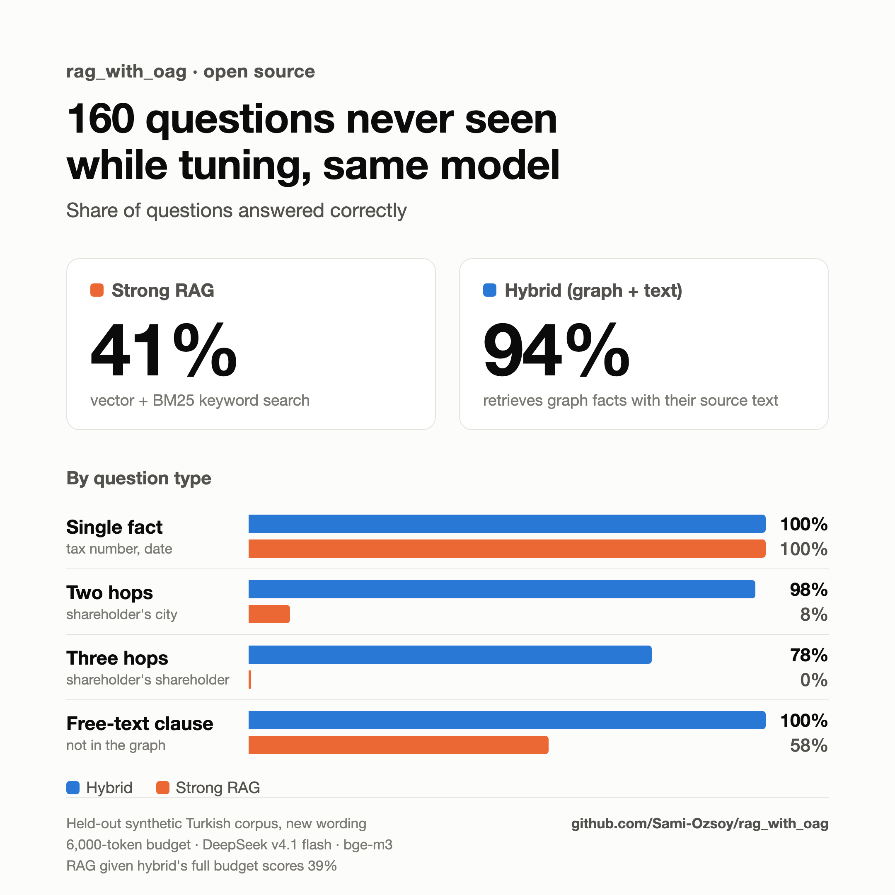
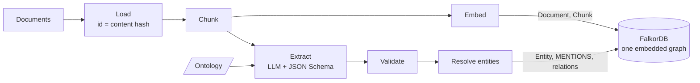
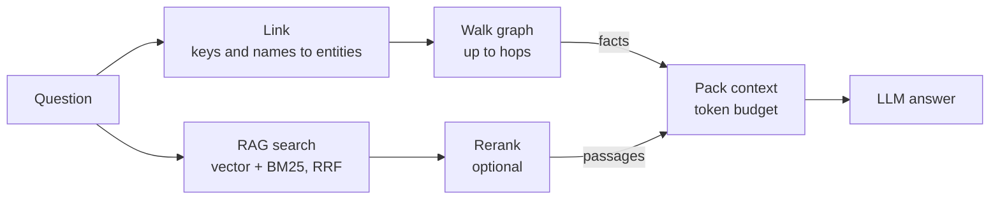

<h1 align="center">
  <picture>
    <source media="(prefers-color-scheme: dark)" srcset="docs/brand/logo-wordmark-dark.png">
    
  </picture>
</h1>

Ask questions about your documents, including questions whose answer is spread
over several documents.

`rag_with_oag` is a Python library that combines two ways of feeding an LLM:

- **RAG**: find the text passages most similar to the question.
- **OAG** (ontology-augmented generation): extract a knowledge graph from the
  documents, following an ontology you define, and walk its relations.

The default **hybrid** mode gives the model both: typed facts from the graph
*and* the source text behind them. Everything lives in **one embedded FalkorDB
graph**, so there is no server to run.

> **Status: v0.2 (pre-alpha).** All three modes (`rag`, `oag`, `hybrid`) work end
> to end. Not on PyPI yet.

## Why

Take this question about a set of contracts and company records:

> *"Who is the largest shareholder of the largest shareholder of the customer in
> contract DS-2023-008?"*

The answer is three hops away, in three different documents (the contract, and
two shareholder records). No single passage looks like the question, so plain
RAG retrieves the wrong text. A graph answers it by following
`contract → customer → shareholder → shareholder`.

On a held-out synthetic Turkish corpus of 593 documents and 160 questions
([details](#evaluation)), generated with sentence patterns that were never seen
while the retrieval settings were tuned:

<p align="center">
  
</p>

<details>
<summary>The same numbers as a table</summary>

| Question type | RAG | RAG at hybrid's budget | Hybrid |
|---|---|---|---|
| Single fact (a tax number, a date) | 100% | 100% | 100% |
| Two hops | 8% | 18% | 98% |
| Three hops | 0% | 0% | 78% |
| Free-text clause (not in the ontology) | 58% | 40% | 100% |
| **All** | **41%** | **39%** | **94%** |

</details>

Answer accuracy with `deepseek-v4.1-flash` for answers and extraction and
`bge-m3` for embeddings, with a 6,000-token context budget. RAG is the strongest
baseline we measured: vector search fused with BM25 keyword search. A
multilingual cross-encoder reranker did not improve it on this data. "RAG at
hybrid's budget" raises `k` until its context is as large as hybrid's; the extra
passages push out the neighbours of the best hit, so it scores slightly lower.
On the default set used for tuning, hybrid scores 98%. This is one synthetic
domain and one model; results on real documents still need to be confirmed.

## Install

```bash
pip install "rag_with_oag @ git+https://github.com/Sami-Ozsoy/rag_with_oag"
```

Extras: `[pdf]` for PDF loading, `[local]` for CPU embeddings without a server.
Python 3.12+. On macOS the embedded database needs OpenMP: `brew install libomp`.

## Quick start

```python
from rag_with_oag import KnowledgeBase, LLMConfig, EmbedConfig, Ontology

kb = KnowledgeBase(
    "contracts",
    path="./rag_with_oag.db",  # embedded FalkorDB file
    llm=LLMConfig(base_url="http://localhost:11434/v1", model="qwen2.5:7b-instruct"),
    embedder=EmbedConfig(model="text-embedding-3-small"),
    ontology=Ontology.from_yaml("ontology.yaml"),  # leave out for RAG only
)

kb.ingest(["docs/"])  # txt, md, rst, html (+ pdf with the extra)

res = kb.query("Which company owns the provider in contract HS-2024-01?")
print(res.answer)  # cites graph facts as [F1] and passages as [C1]
kb.close()
```

What else a result holds:

```python
res.facts  # typed facts from the graph
res.chunks  # source passages
res.mode_used  # "hybrid", or "rag" if nothing in the question matched the graph

ctx = kb.retrieve("...", mode="oag")  # retrieval only, no LLM call
```

`AsyncKnowledgeBase` offers the same API with `await`. To use a FalkorDB server
instead of the embedded file, pass `url="redis://localhost:6379"` instead of `path`.

## Models

Any OpenAI-compatible endpoint works for the answer model (`llm`), the extraction
model (`extractor_llm`, defaults to `llm`) and the embedder: OpenAI, vLLM,
Ollama, LM Studio, OpenRouter, Groq.

- **API keys:** pass `api_key=` or set `RAG_OAG_LLM_API_KEY` /
  `RAG_OAG_EMBED_API_KEY`. `OPENAI_API_KEY` is used only when `base_url` points at
  OpenAI itself; it is never sent to another server.
- **Ollama:** raise the context window. Ollama serves 4,096 tokens by default,
  which a hybrid context alone can fill (`OLLAMA_CONTEXT_LENGTH=16384`, or
  `PARAMETER num_ctx 16384` in the model file). A model that runs out before
  answering raises `OutputTruncatedError`.
- **Embedding prefixes:** models trained with instructions need them on every
  text, e.g. `EmbedConfig(model="nomic-embed-text", query_prefix="search_query: ",
  document_prefix="search_document: ")`. The prefix is recorded with the knowledge
  base, which then refuses to open without it.
- **Local embeddings:** with the `local` extra, pass
  `embedder=FastEmbedEmbedder(...)` from `rag_with_oag.embed.local`. The default
  `BAAI/bge-small-en-v1.5` (67 MB) is English only; for other languages use a
  multilingual model such as `Qwen/Qwen3-Embedding-0.6B-Q` (1.1 GB, Apache-2.0),
  whose prefixes are filled in automatically.

## Ontology

The ontology tells the extraction model what to look for: entity types, their
properties, and the relations between them. Write it in YAML, or build it from
Pydantic classes with `Ontology.from_classes`.

```yaml
name: contracts
entities:
  Sirket:                    # company
    description: A company that is party to contracts or owns shares in other companies
    key: vergi_no            # identifying property: same tax number = same company
    properties:
      vergi_no: string
      sehir: {type: string, description: City of the head office}
  Sozlesme:                  # contract
    key: numara
    properties:
      numara: string
      imza_tarihi: date
relations:
  TARAFIDIR:                 # company is a party to a contract
    source: Sirket
    target: Sozlesme
    properties:
      rol: {type: enum, values: [musteri, saglayici]}
  ORTAGIDIR: {source: Sirket, target: Sirket, properties: {oran: number}}  # owns shares
```

- Type names become graph labels, so they must be ASCII identifiers.
  Descriptions can be in any language: they are what the extraction model reads.
- A `key` is what makes two mentions the same entity. Without one, names are
  compared, ignoring legal forms such as "A.Ş.", "Ltd." or "GmbH" (extend the list
  with `name_suffixes`).
- The ontology's fingerprint is stored in the graph. Opening a knowledge base with
  a changed ontology raises `OntologyMismatchError` instead of mixing two schemas.
  Adding an ontology to a RAG-only knowledge base extracts the existing documents
  on the next `ingest`.

## Modes

| Mode | Finds its starting point by | Gives the model |
|---|---|---|
| `rag` | vector and BM25 keyword search over passages | the best passages and their neighbours |
| `oag` | matching names and keys in the question to graph entities | facts from walking the graph up to `hops` relations away |
| `hybrid` (default) | both | graph facts, passages from the documents the matched entities appear in, and the best RAG passages |

`kb.query(..., mode="rag")` picks a mode per question. Hybrid falls back to RAG,
and says so in `mode_used`, when nothing in the question matches the graph.

### Tuning

Pass `retrieval=RetrievalConfig(...)` to `KnowledgeBase`. The defaults suit most
cases; the ones worth knowing:

| Setting | Default | Meaning |
|---|---|---|
| `context_token_budget` | 6000 | Upper limit for the whole context, headers included |
| `hops` | 3 | How many relations away from the question's entities the graph walk goes |
| `max_fanout` | 8 | Edges kept per entity, relation type and direction, so 30 contracts cannot crowd out 2 shareholders |
| `fact_budget_ratio` | 0.6 | Maximum share of the budget for graph facts in hybrid |
| `hybrid_text_reserve` | 4 | Passages hybrid always keeps ahead of facts |
| `link_exact_anchors` | `True` | A key or full name written in the question makes that entity the only starting point |
| `rag_lexical` | `True` | Fuse BM25 keyword ranks with vector ranks for RAG passages (in `rag` and `hybrid`) |
| `rerank_candidates` | 30 | Passages a reranker rescores, when one is passed |

A cross-encoder reranker is optional: `KnowledgeBase(..., reranker=FastEmbedReranker())`
from `rag_with_oag.rerank.local` (the `local` extra). It runs on CPU and did not
help on our evaluation sets, so it is off by default.

## CLI

```bash
export RAG_OAG_EMBED_MODEL=text-embedding-3-small
export RAG_OAG_LLM_MODEL=gpt-4o-mini       # *_BASE_URL and *_API_KEY as needed
rag-with-oag ingest docs/ --kb contracts --ontology ontology.yaml
rag-with-oag query "Who owns the provider?" --kb contracts --ontology ontology.yaml
rag-with-oag query "..." --kb contracts --mode rag --retrieve-only --json
```

## How it works

### Ingest



For each document:

1. **Load.** A document's id is its content hash, so ingesting unchanged content
   again does nothing. When a source (a file path) comes back with new content,
   the new version is written and extracted first, then the old version is
   removed (`replace=False` keeps both). Identical content under two sources is
   one document.
2. **Chunk.** [adaptive-oci-chunking](https://pypi.org/project/adaptive-oci-chunking/)
   picks a strategy per document. Each chunk keeps its section path and page.
3. **Embed** the chunks. The embedding model and dimension are recorded; opening
   the knowledge base with a different embedder is an error.
4. **Store** `Document -[:HAS_CHUNK]-> Chunk -[:NEXT]-> Chunk`. RAG works from here.
5. **Extract.** Chunks go to the model in batches with a JSON Schema generated
   from the ontology. If the endpoint lacks `json_schema`, it falls back to tool
   calling, then `json_object`, then plain-prompt JSON, and remembers what works.
6. **Validate** types, relation endpoints, required properties and enum values.
   Invalid output goes back to the model once with the errors; what is still
   invalid is dropped and reported.
7. **Resolve** mentions into entities. The same key means the same entity. A
   mention without a key joins the entity with the same name. A remaining new
   mention joins a near-duplicate by embedding similarity, but only when one
   name's words contain the other's: "Zirve" joins "Zirve Gıda A.Ş.", while
   "Kemer Ambalaj" never joins "Bahar Ambalaj".
8. **Write** entities as `Entity:<Type>` nodes, `Chunk -[:MENTIONS]-> Entity`
   links, and relations that list their source chunks as evidence.

`kb.ingest` returns an `IngestReport`: documents, chunks, entities, relations,
rejected extraction items, concepts the ontology could not express, and token
usage. Extraction results are cached per chunk, ontology, model and prompt; a
document whose extraction failed is retried on the next ingest.

### Retrieval



`oag` uses the upper path, `rag` the lower one, and `hybrid` both; hybrid falls back to the
lower path when nothing in the question matches the graph.

1. **Link.** Keys and full names written in the question are matched exactly.
   Otherwise full-text and vector matches on entity names are fused.
2. **Walk.** From the matched entities, the graph is expanded one hop at a time,
   both directions, up to `hops`. Facts are ordered by distance, so when the
   budget runs out the farthest ones are dropped first.
3. **Search passages.** Vector search and an in-memory BM25 index (built on
   first use, rebuilt after writes) are fused with Reciprocal Rank Fusion.
   Turkish words are folded and cut to six letters, so "sözleşmesindeki" matches
   "sözleşme"; keys like `KS-2024-002` are single tokens, so `DS-2024-002` does
   not match.
4. **Pack** (hybrid). Passages from the documents the matched entities appear in
   and the top RAG passages are reserved first. Graph facts come next, then the
   remaining passages, fused with Reciprocal Rank Fusion.

### Delete

`kb.delete("docs/contract.md")` (or a document id) removes a document and
returns a `DeleteReport`:

- Its chunks go, and their ids are removed from each relation's evidence.
- A relation with no evidence left is deleted. One that another document also
  states stays.
- Entities that are no longer mentioned anywhere and have no relations are
  deleted.

Entity properties are not rolled back: a property only the deleted document
stated keeps its last value until another document sets it. Ingest and delete
take a write lock, so they never interleave; queries do not wait.

```bash
rag-with-oag delete docs/contract.md --kb contracts
```

### Raw Cypher

`kb.store.query(cypher, params)` runs raw Cypher. It is documented but outside
the API stability promise. Inside the library, labels and relationship types
reach Cypher only from the validated ontology; every other value is a parameter.

## Evaluation

Two evaluation sets ship with the repository:

- **`eval/golden`**: 14 contract documents and 33 questions. Small and readable;
  strong models answer all of it.
- **`eval/synthetic`**: a generator for large Turkish corpora with known ground
  truth. The default set has 596 documents (526k tokens), 450 entities, 749
  relations and 160 questions in four groups. It includes confusable company
  names, passive and reversed phrasing, and facts spread over documents. Each
  question records its answer chain and the sentence that states each hop.
  `--variant b` uses separate sentence, document and question templates;
  `eval/synthetic/sets/heldout` (seed 101) is built with it and shares no
  sentence with the default set, so it checks that tuning did not overfit.

```bash
python eval/run_golden.py --base-url http://localhost:11434/v1 \
    --llm qwen2.5:7b-instruct --embed nomic-embed-text --answers --equal-budget

python eval/run_golden.py --set eval/synthetic/sets/heldout --kb heldout \
    --llm <model> --embed bge-m3 --answers --equal-budget
```

`--no-lexical` turns BM25 fusion off and `--rerank MODEL` adds a FastEmbed
cross-encoder, to compare RAG baselines.

What the runner reports per mode and question group:

- **Chain hit:** whether every hop of the answer chain reached the context, as a
  graph fact or as its source sentence. This is cheap (no LLM) and tracks answer
  accuracy closely. A plain "answer string appears somewhere" check is also
  printed, but it overrates crowded contexts.
- **Answer accuracy** with `--answers`.
- **`rag_eq`** with `--equal-budget`: RAG with `k` raised until its context is as
  large as hybrid's, so modes are compared at the same token budget.
- **Graph quality** for the synthetic set: missing, extra and duplicate entities;
  relation precision, recall and reversed edges; property accuracy.

`eval/sweep_retrieval.py` sweeps retrieval settings on an ingested knowledge base
without calling an LLM. `--seed-cache-from KB` copies another knowledge base's
extraction cache, so a re-ingest after a resolver change makes no LLM calls.

## Development

```bash
python3.12 -m venv .venv && .venv/bin/pip install -e ".[dev]"
.venv/bin/pytest                 # embedded FalkorDB and fake models: no network or Docker
.venv/bin/ruff check . && .venv/bin/mypy
python spikes/m0_falkordb.py     # M0 backend spike: recall, latency, memory
```

## Roadmap

| Milestone | Scope |
|---|---|
| M0 | FalkorDB spike: ANN recall, hybrid latency, memory |
| M1 (v0.1) | Skeleton and RAG |
| **M2 (v0.2)** | Ontology, extraction, OAG and hybrid modes, evaluation sets ← *you are here* |
| M3 (v0.3) | `Ontology.suggest()`, streaming, ~~re-ingest and delete~~ (done), `reembed()`, observability |

MIT licensed.
