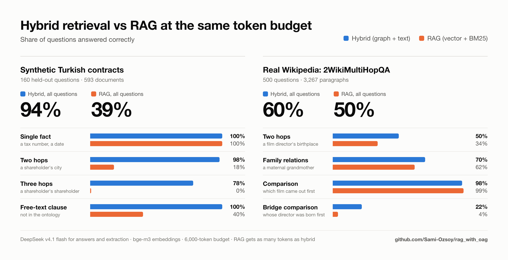

# Evaluation

[← Back to README](../README.md)

The chart compares hybrid and RAG on a held-out synthetic Turkish corpus of 593
documents and 160 questions. The corpus uses sentence patterns that were never
seen while the retrieval settings were tuned. See [evaluation sets and commands](#evaluation-sets-and-commands)
and [results on 500 Wikipedia questions](#on-real-documents).

<p align="center">
  <picture>
    <source media="(prefers-color-scheme: dark)" srcset="images/rag_vs_hybrid-dark.png">
    
  </picture>
</p>

## Synthetic contracts

| Question type | RAG | RAG at hybrid's budget | Hybrid |
|---|---|---|---|
| Single fact (a tax number, a date) | 100% | 100% | 100% |
| Two hops | 8% | 18% | 98% |
| Three hops | 0% | 0% | 78% |
| Free-text clause (not in the ontology) | 58% | 40% | 100% |
| **All** | **41%** | **39%** | **94%** |

Answer accuracy with `deepseek-v4.1-flash` for answers and extraction and
`bge-m3` for embeddings, with a 6,000-token context budget. RAG is the strongest
baseline we measured. It fuses vector search with BM25 keyword search. A
multilingual cross-encoder reranker did not improve it on this data. "RAG at
hybrid's budget" raises `k` until its context is as large as hybrid's. The extra
passages push out the neighbours of the best hit, so it scores slightly lower.
On the default set used for tuning, hybrid scores 98%. This covers one synthetic
domain.

## On real documents

On 500 questions from the [2WikiMultiHopQA](https://github.com/Alab-NII/2wikimultihop) dev set,
over 3,267 English Wikipedia paragraphs, with an ontology drafted by `Ontology.suggest()` and
then reviewed, the gap is smaller than on the synthetic set but clear.

| Question type | RAG | RAG at hybrid's budget | Graph only (`oag`) | Hybrid |
|---|---|---|---|---|
| Compositional ("Where was the director of film X born?") | 28% | 34% | 40% | 58% |
| Inference ("Who is X's maternal grandmother?") | 47% | 65% | 62% | 71% |
| Comparison ("Which film came out first, X or Y?") | 99% | 99% | 82% | 99% |
| Bridge comparison ("Which film has the director born first?") | 0% | 2% | 63% | 67% |
| **All** | **44%** | **50%** | **62%** | **74%** |

The models and budget were the same as above. Extraction ran with `reasoning_effort="none"`. Hybrid answered
141 questions that RAG at the same budget missed and missed 21 that it answered (McNemar test,
p < 0.001). An answer that says the evidence is insufficient counts as wrong. Hybrid gave one to
17% of the questions and RAG at the same budget to 41%. Comparison questions name both entities, so
plain search finds both passages and the graph adds nothing. Bridge comparisons need four facts
from four documents and never name the directors, so RAG almost never finds their paragraphs,
while the graph walks film → director → date. Most remaining graph misses come from one person
stored as two entities under different names (for example "Howard Hawks" and "Howard Winchester
Hawks"), so the date sits on a node the walk does not reach. Wikipedia is likely in the model's
training data, which affects all modes alike.

## Evaluation sets and commands

Two evaluation sets ship with the repository, and a third is built from public data.

- **`eval/golden`** has 14 contract documents and 33 questions. It is small and readable, and
  strong models answer all of it.
- **`eval/synthetic`** generates large Turkish corpora with known ground
  truth. The default set has 596 documents (526k tokens), 450 entities, 749
  relations and 160 questions in four groups. It includes confusable company
  names, passive and reversed phrasing, and facts spread over documents. Each
  question records its answer chain and the sentence that states each hop.
  `--variant b` uses separate sentence, document and question templates.
  `eval/synthetic/sets/heldout` (seed 101) is built with it and shares no
  sentence with the default set, so it checks that tuning did not overfit.
- **`eval/external/twowiki`** builds a sample of the 2WikiMultiHopQA dev set (questions, their
  Wikipedia paragraphs and gold evidence). Download the data by following the
  [2WikiMultiHopQA instructions](../eval/external/twowiki/README.md).

```bash
python eval/run_golden.py --base-url http://localhost:11434/v1 \
    --llm qwen2.5:7b-instruct --embed nomic-embed-text --answers --equal-budget

python eval/run_golden.py --set eval/synthetic/sets/heldout --kb heldout \
    --llm <model> --embed bge-m3 --answers --equal-budget
```

`--no-lexical` turns BM25 fusion off and `--rerank MODEL` adds a FastEmbed
cross-encoder, to compare RAG baselines.

The runner reports these metrics per mode and question group.

- **Chain hit.** Whether every hop of the answer chain reached the context, as a
  graph fact or as its source sentence. This is cheap (no LLM) and tracks answer
  accuracy closely. A plain "answer string appears somewhere" check is also
  printed, but it overrates crowded contexts.
- **Answer accuracy** with `--answers`.
- **Evidence hit** and **document recall** for sets with gold evidence. They measure whether every gold fact
  value, and every gold document, reached the context. No LLM is needed.
- **Refusals** with `--answers`. The share of answers that say the evidence is insufficient.
  On choice questions a refusal counts as wrong.
- **`rag_eq`** with `--equal-budget`. RAG with `k` raised until its context is as
  large as hybrid's, so modes are compared at the same token budget.
- **Graph quality** for the synthetic set includes missing, extra and duplicate entities,
  relation precision and recall, reversed edges, and property accuracy.

`eval/sweep_retrieval.py` sweeps retrieval settings on an ingested knowledge base
without calling an LLM. `--seed-cache-from KB` copies another knowledge base's
extraction cache, so a re-ingest after a resolver change makes no LLM calls.
