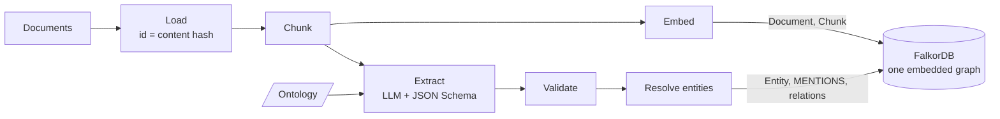
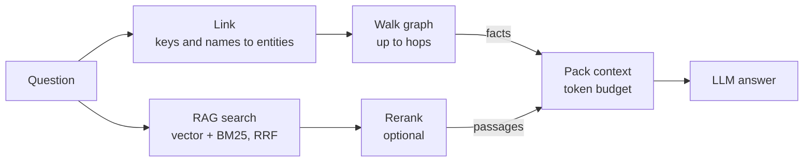

# How it works

[← Back to README](../README.md)

## Modes

| Mode | Finds its starting point by | Gives the model |
|---|---|---|
| `rag` | vector and BM25 keyword search over passages | the best passages and their neighbours |
| `oag` | matching names and keys in the question to graph entities | facts from walking the graph up to `hops` relations away |
| `hybrid` (default) | both | graph facts, passages from the documents the matched entities appear in, and the best RAG passages |

`kb.query(..., mode="rag")` picks a mode per question. Hybrid falls back to RAG,
and says so in `mode_used`, when nothing in the question matches the graph.

For RAG only, leave out the ontology when opening a knowledge base.

## Ingest

`kb.ingest` accepts files or directories with TXT, Markdown, reStructuredText
and HTML documents. The `pdf` extra adds PDF support.



These steps run for each document.

1. **Load.** A document's id is its content hash, so ingesting unchanged content
   again does nothing. When a source (a file path) comes back with new content,
   the new version is written and extracted first, then the old version is
   removed (`replace=False` keeps both). Identical content under two sources is
   one document.
2. **Chunk.** [adaptive-oci-chunking](https://pypi.org/project/adaptive-oci-chunking/)
   picks a strategy per document. Each chunk keeps its section path and page.
3. **Embed** the chunks. The embedding model and dimension are recorded.
   Opening the knowledge base with a different embedder is an error.
4. **Store** `Document -[:HAS_CHUNK]-> Chunk -[:NEXT]-> Chunk`. RAG works from here.
5. **Extract.** Chunks go to the model in batches with a JSON Schema generated
   from the ontology. If the endpoint lacks `json_schema`, it falls back to tool
   calling, then `json_object`, then plain-prompt JSON, and remembers what works.
6. **Validate** types, relation endpoints, required properties and enum values.
   Invalid output goes back to the model once with the errors. Any remaining
   invalid output is dropped and reported.
7. **Resolve** mentions into entities. The same key means the same entity. A
   mention without a key joins the entity with the same name. A remaining new
   mention joins a near-duplicate by embedding similarity, but only when one
   name's words contain the other's. "Zirve" joins "Zirve Gıda A.Ş.", while
   "Kemer Ambalaj" never joins "Bahar Ambalaj".
8. **Write** entities as `Entity:<Type>` nodes, `Chunk -[:MENTIONS]-> Entity`
   links, and relations that list their source chunks as evidence.

`kb.ingest` returns an `IngestReport` with documents, chunks, entities, relations,
rejected extraction items, concepts the ontology could not express, and token
usage. Extraction results are cached per chunk, ontology, model and prompt. If
extraction fails for a document, the next ingest retries it.

## Retrieval



`oag` uses the upper path, `rag` the lower one, and `hybrid` both. Hybrid falls back to the
lower path when nothing in the question matches the graph.

1. **Link.** Keys and full names written in the question are matched exactly.
   Otherwise full-text and vector matches on entity names are fused.
2. **Walk.** From the matched entities, the graph is expanded one hop at a time,
   both directions, up to `hops`. Facts are ordered by distance, so when the
   budget runs out the farthest ones are dropped first.
3. **Search passages.** Vector search and an in-memory BM25 index (built on
   first use, rebuilt after writes) are fused with Reciprocal Rank Fusion.
   Turkish words are folded and cut to six letters, so "sözleşmesindeki" matches
   "sözleşme". Keys like `KS-2024-002` are single tokens, so `DS-2024-002` does
   not match.
4. **Pack** (hybrid). Passages from the documents the matched entities appear in
   and the top RAG passages are reserved first. Graph facts come next, then the
   remaining passages, fused with Reciprocal Rank Fusion.

Use `kb.retrieve` to get the context without asking the LLM to answer.

```python
ctx = kb.retrieve("Which company owns the provider in contract HS-2024-01?", mode="oag")
```

## Delete

`kb.delete("docs/contract.md")` (or a document id) removes a document and
returns a `DeleteReport`.

- Its chunks go, and their ids are removed from each relation's evidence.
- A relation with no evidence left is deleted. One that another document also
  states stays.
- Entities that are no longer mentioned anywhere and have no relations are
  deleted.

A property stated only by the deleted document keeps its last value until
another document sets it. Ingest and delete take a write lock, so they never
interleave. Queries do not wait.

```bash
rag-with-oag delete docs/contract.md --kb contracts
```

## Milestones

| Milestone | Scope |
|---|---|
| M0 | FalkorDB spike for ANN recall, hybrid latency and memory |
| M1 (v0.1) | Skeleton and RAG |
| M2 (v0.2) | Ontology, extraction, OAG and hybrid modes, evaluation sets |
| **M3 (v0.3)** | ~~`Ontology.suggest()`~~ (done), streaming, ~~re-ingest and delete~~ (done), `reembed()`, observability ← *you are here* |
